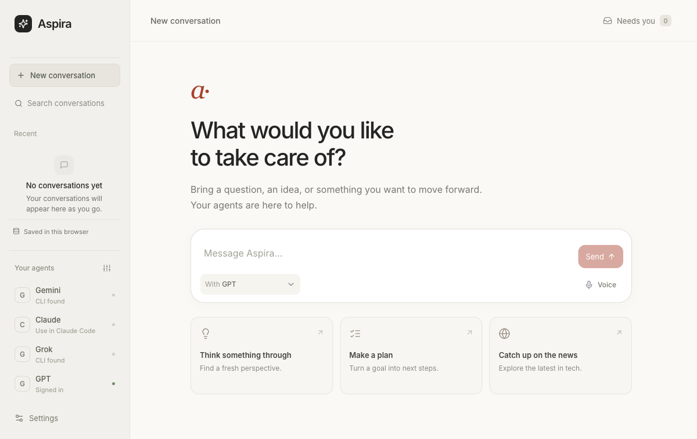

<div align="center">
  
  <h1>Aspira</h1>
  <p><strong>Your models. One conversation. Actions you can review.</strong></p>
  <p>An open-source, macOS-first workspace for talking with the AI tools you already use.</p>
  <p>
    <a href="https://github.com/ysham123/Aspira/blob/main/LICENSE"></a>
    
    
    
  </p>
</div>

<p align="center">
  
</p>

Aspira brings supported model subscriptions, direct model APIs, built-in browser voice, and a small set of useful computer actions into one private workspace. Pick one agent or ask several for their perspectives, then keep the conversation and action receipts together.

> **Aspira is an early v1 preview.** Each provider exposes different capabilities and account rules. A model's desktop app or paid subscription does not automatically make every feature available inside Aspira. See [provider support](#connect-your-models) before you set it up.

## Start in a few minutes

### Requirements

- macOS
- Node.js 20 or later and npm
- Google Chrome, if you plan to use the optional browser-control tools

### Run Aspira

Clone the repository, or choose **Code → Download ZIP** on GitHub and unzip it. To clone with Git:

```sh
git clone https://github.com/ysham123/Aspira.git
cd Aspira
npm ci
npm run dev
```

For the ZIP download, open a terminal in the extracted project folder and run:

```sh
npm ci
npm run dev
```

Open [http://127.0.0.1:5173](http://127.0.0.1:5173). `npm run dev` starts the local web app and API. Both bind to loopback on your Mac. Choose a provider in **Settings → Your agents**, then start a conversation. The source download does not include model weights; optional voice models download into the browser cache the first time you use voice.

To open the studio in a frameless browser window, leave the development server running and open a second terminal:

```sh
npm run desktop
```

## What you can do

- **Bring providers into one conversation.** Select one agent or several. Each selected agent returns its own answer; Aspira can ask the lead agent for one additional synthesis and keeps the original contributions available. That extra model request can use provider quota or API credits.
- **Ask for practical actions.** Depending on the provider path, an agent can open supported Mac apps, check Git or basic system status, search and read project files, create a new file, or prepare an existing-file edit for review.
- **Review changes before they land.** File edits appear as diffs. Apply checks that the reviewed version is still current; Undo is available while the file still matches the applied result.
- **Use everyday Mac apps.** Ask Aspira to create a Reminders item or a Notes note, or open an unsent email draft for you to review.
- **Work with public web pages.** Open a site in Aspira's separate Chrome profile, ask an agent to read it, click a named safe control, or fill a non-secret field. Sign in manually in that browser profile.
- **Speak when you want to.** Aspira includes opt-in English transcription and speech playback in the browser. Recording starts only after you press the voice control; there is no always-listening wake word or separate speech service to connect.
- **Pick up where a turn stopped.** Aspira saves conversation drafts and can recover received replies and action receipts after a reload. It does not resume provider work in the background.

### Try a conversation

With a connected provider selected, try:

```text
Read README.md and explain how to start the app.
Remind me to pick up milk tomorrow.
Create a note called Shopping with apples and eggs.
Draft an email about the trip and leave it open for review.
Open example.com and summarize the page.
Click the Pricing link on this page.
```

For an existing project file, ask for a reviewed edit:

```text
In notes.md, replace "Status: draft" with "Status: ready" and prepare the edit for review.
```

Aspira returns a diff and waits for you to choose **Apply change** or **Discard**. It does not overwrite the file just because an agent suggested an edit.

## Connect your models

Aspira uses the integration each provider permits. A CLI being installed only confirms that the command is available; it does not confirm a plan tier or guarantee sign-in. Provider subscriptions and product terms can change.

| Provider | Subscription path in Aspira | Current boundary | Official setup |
| --- | --- | --- | --- |
| **Google** | Antigravity CLI (`agy`) | Headless plan-mode replies; Google CLI handles sign-in. Aspira checks CLI availability, not subscription status. | [Install and authenticate](https://www.antigravity.google/docs/cli/install/) |
| **OpenAI** | Codex CLI app-server (`codex`) | Uses the signed-in Codex session, streams replies, resumes a thread per Aspira conversation, and can request Aspira's structured actions. The Codex workspace runs read-only; file edits still need your review. | [Codex CLI](https://github.com/openai/codex) · [App-server overview](https://developers.openai.com/blog/codex-as-a-platform) |
| **Anthropic** | Claude Code (`claude`) | Subscription conversations open in Claude Code. For Claude replies inside Aspira, add your own Anthropic API key. | [Install and sign in](https://docs.anthropic.com/en/docs/claude-code/getting-started) |
| **xAI** | Grok Build CLI (`grok`) | One headless plan-mode reply in a temporary workspace; Grok's provider-native tools are disabled. Aspira checks CLI availability, not account or plan status. | [Install and get started](https://docs.x.ai/build/overview) · [CLI reference](https://docs.x.ai/build/cli/reference) |

You can also configure an explicit provider API key or an OpenAI-compatible endpoint in **Settings → Advanced**. Those are separate from subscription access. An optional Ollama-compatible endpoint can connect a local model; Aspira does not silently switch providers or use a key from your shell environment.

When a subscription cannot answer inside Aspira, use **Open in [provider]** to copy the prompt and open that provider's app or site. Review it there and submit it yourself. Aspira does not press Send.

## Actions and safety

The selected lead agent can request actions from Aspira's bounded tool set. The server checks the request against what you asked and returns the actual result to the conversation. Turns are limited to three action calls.

Aspira can:

- read, search, and list eligible project text files; create a new file; prepare a reviewed exact edit;
- check Git status and basic Mac system status;
- open an allowlisted Mac app or a public web address;
- read a browser page when you ask, click a visible control by its exact accessible name, or fill a visible non-secret field;
- create Notes and Reminders items, open an unsent Mail draft, search the public web, and save a memory when you ask.

Aspira does **not** run arbitrary shell commands, send email, submit browser forms, click high-impact web controls, overwrite existing files without review, or execute routines on a schedule. Browser tools use a separate Chrome profile; Aspira blocks local/private-network HTTP and WebSocket addresses and refuses password, payment, recovery, and secret fields. Page text is sent to your selected provider only when you ask Aspira to read that page. Opening a page, clicking a control, or filling a field returns a compact receipt without echoing the page text or field value.

## Voice

Voice is part of the app, not a local service you need to install or connect. Aspira runs Whisper Tiny English transcription and Kokoro-82M speech generation in a browser worker. Their model files download from Hugging Face the first time you use voice, then stay cached by your browser. Audio processing stays in the browser; when you send a voice message, its transcript goes to your selected agent like typed text.

Voice is **press-to-record**, not continuous or full-duplex conversation. Open **Voice**, choose **Record a message**, then choose **Stop & send** when you are done. The optional passphrase lock is a convenience screen for this browser, not device authentication.

## Privacy and local data

- The web app and Express API listen on `127.0.0.1`; Aspira is not a hosted service.
- Conversations are stored in this browser's local storage. They are not synced or encrypted.
- Memories, routines, edit proposals, Codex thread links, and the Aspira Chrome profile live under `server/data/` and are ignored by Git. Local files are not encrypted.
- Provider requests include your prompt, a bounded recent conversation history, and up to eight saved memory notes. If you ask an agent to use a tool, its bounded result is sent to that same provider so it can respond.
- API keys configured in Aspira are stored in this browser's local storage. Do not treat the passphrase lock or browser storage as a secrets vault.

## Development

```sh
npm test
npx tsc --noEmit
npm run build
```

To run the services separately instead of `npm run dev`, use two terminals:

```sh
npm run server
```

```sh
npm run client
```

See [the architecture notes](docs/ARCHITECTURE.md) for provider flow, tool boundaries, conversation recovery, and file-edit behavior. Issues and pull requests are welcome.

## License

Aspira is released under the [MIT License](LICENSE).
