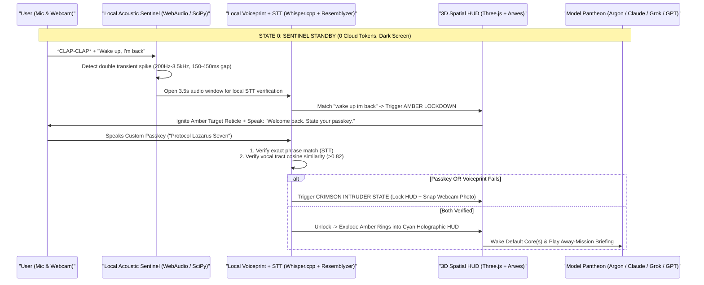
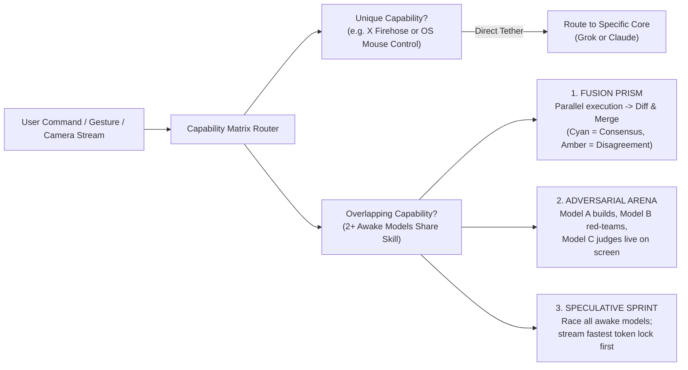
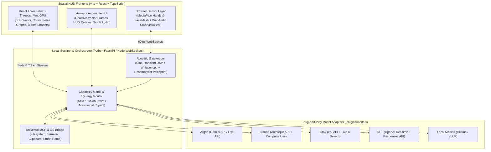

# Project A.R.C.H.O.N. — Open-Source Multi-Model Spatial HUD Blueprint

> [!IMPORTANT]
> **What Exists Today vs. What We Are Designing:**
> Current open-source "JARVIS HUD" projects on GitHub (such as `jarvis-hud`, `Jarvis-3D-GestureControl`, `my-jarvis`, and `eDEX-UI`) do **one of two things**: they either render a decorative 3D particle sphere hooked up to a single chatbot, or they display static sci-fi terminal monitors. **None of them** treat multiple AI models (**Argon, Grok, Claude, GPT**) as physical, interactive reactor cores whose native and overlapping capabilities dynamically reshape the UI itself.

---

## 1. The Core Vision: Why This Has Never Been Done

Instead of building 50 hardcoded features or a glorified chat window with a model dropdown, **A.R.C.H.O.N.** (*Autonomous Reactive Cognitive Hologram & Orchestrated Nexus*) is a **100% open-source, plug-and-play spatial exocortex**:

1. **Zero-Config Capability Extraction:** You drop in an API key or plugin manifest for **Argon (Gemini)**, **Claude**, **Grok**, or **GPT** (plus any future local or cloud model), and the system automatically exposes every native capability that model possesses (vision, voice, computer use, MCP tools, live social search, code execution, deep reasoning).
2. **Overlapping Capability Synergy (The "Fusion Reactor"):** Where models overlap (e.g., all four can reason, code, and analyze images), the HUD doesn't force you to pick just one—it visually lets you **Fuse**, **Race**, or **Pit Them Against Each Other** in real time.
3. **Selective Cryo-Sleep & Awakening:** You decide which brains are awake. Sleeping models sit in a low-power outer orbital ring consuming **zero tokens**. You wake them on demand by voice (*"Wake up Argon and Claude"*), by physically flicking their 3D core into the central reactor with your hand (via webcam tracking), or via auto-routing.
4. **Transformative Geometry (No Static Layout):** The interface has no permanent sidebars or chat boxes. The entire screen topology morphs between **Reactor Nexus**, **Exploded 3D Code Forge**, **Tactical Overwatch Visor**, and **Adversarial War Room** depending on what the awake models are doing.

---

## 2. The Signature Boot Sequence: Clap $\rightarrow$ Wake Phrase $\rightarrow$ Voice Passkey

In **Sentinel Standby Mode**, zero cloud APIs run. A lightweight local audio pipeline listens on your microphone at `<1%` CPU with a pitch-black screen (or a faint, pulsing heart-rate line).



### How We Make the Passkey 10x Cooler Than a Simple Password
````carousel
### Layer 1: Acoustic Double-Clap + Wake Phrase
A standard wake-word engine can false-trigger on YouTube videos or background speech. By combining a **hardware-level acoustic impulse detector** (measuring the sharp crest factor and sub-50ms decay of a real room clap) with the phrase **"Wake up, I'm back"**, the system only wakes up to physical presence in your room.
<!-- slide -->
### Layer 2: Dual Voiceprint + Semantic Passkey
When the HUD asks for your passkey, it doesn't just transcribe the words. Using an open-source speaker embedding model (**Resemblyzer** or **SpeechBrain ECAPA-TDNN**), it extracts a 256-dimensional vector of your vocal cords. Even if a friend hears your custom passkey and repeats it right after clapping, the HUD flashes **Crimson: "VOICE SIGNATURE MISMATCH — ACCESS DENIED."**
<!-- slide -->
### Layer 3: Duress / Decoy Passkey & Away-Briefing
You can configure **multiple passkeys** that boot the HUD into different states:
- **Primary Passkey:** Wakes **Argon + Claude**, unlocks all local files/MCP tools, and delivers a 15-second voice briefing of background tasks completed while you were gone.
- **Stealth / Guest Passkey:** Boots a "Sanitized Demo Mode" HUD with only Grok/GPT awake and personal memory vaults hidden.
- **Full Pantheon Passkey (*"House Party Protocol"*):** Wakes all 4 models simultaneously in high-power parallel mode.
````

---

## 3. Plug-and-Play Capability Matrix: Utilizing 100% of Every Model

Instead of coding separate tools, every model registers a declarative **`capability.manifest.json`**. The HUD reads the capabilities of whichever models are currently **Awake** and dynamically lights up the corresponding spatial modules.

| Capability Domain | **ARGON (Gemini)** | **CLAUDE** | **GROK** | **GPT** | How the Display Visualizes It |
| :--- | :---: | :---: | :---: | :---: | :--- |
| **Unique Superpower** | **1M+ Context Vault & Native Video/Screen Stream** | **OS Computer Use (Mouse/Keys) & Deep Code Forge** | **Live X Firehose & Unfiltered Contrarian Pulse** | **WebRTC Sub-Second Voice & Mid-Sentence Tool Calls** | Dedicated **Apex Modules** that only materialize when that specific core is awake |
| **Deep Reasoning & Planning** | ⚡ Overlap | ⚡ Overlap | ⚡ Overlap | ⚡ Overlap | **Synaptic Consensus Prism** (merges or debates plans in 3D space) |
| **Code Synthesis & Debugging** | ⚡ Overlap | ⚡ Overlap | ⚡ Overlap | ⚡ Overlap | **3D Exploded AST Forge** (Claude writes, Argon audits whole-repo context, GPT tests) |
| **Vision & Spatial Camera** | ⚡ Overlap (Live Stream) | ⚡ Overlap (Snapshots) | ⚡ Overlap (Snapshots) | ⚡ Overlap (Realtime) | **Tactical Visor Overlay** on your webcam/screen with bounding reticles |
| **Web & Live Intelligence** | ⚡ Overlap (Google Search) | ⚡ Overlap (Web Fetch) | ⚡ Overlap (Live X + Web) | ⚡ Overlap (Search) | **Holographic Recon Globe** pinning live sources and cross-checking claims |
| **Image / Visual Generation** | ⚡ Overlap (Imagen) | *(SVG / Artifacts)* | ⚡ Overlap (Aurora) | ⚡ Overlap (GPT-Image) | **Holo-Canvas Carousel** generating side-by-side visual concepts |

---

## 4. Overlapping Features: The "Trinity of Synergy" Engine

Most multi-model apps treat overlapping features as redundant. **A.R.C.H.O.N.** turns overlap into its greatest spectacle. Whenever two or more awake models share a capability required by your command, you can switch between **three visual reactor modes**:



1. **Fusion Mode (The Consensus Prism):** Ask a complex architectural or strategy question with **Argon, Claude, and GPT** awake. Three glowing particle beams fire from their respective orbital cores into a central 3D prism. The HUD renders one unified hologram where **high-consensus truths glow solid Cyan**, and **divergent model opinions pulse Amber**—tap an Amber node to expand why Claude disagreed with Argon.
2. **Adversarial Arena (Red-Team Mode):** Have **Claude** draft code or a plan while **Grok** automatically acts as a ruthless adversary trying to break it, and **Argon** verifies both against your entire codebase. You watch them trade counter-strikes in real time on a split tactical display.
3. **Relay Pipeline (Chained Superpowers):** Automatic handoffs across unique capabilities in a single breath:
   - *Grok* spots a breaking trend on X $\rightarrow$ hands context packet to *Argon* to analyze against a 500-page PDF/repo $\rightarrow$ hands spec to *Claude* to write and execute the code on your desktop $\rightarrow$ *GPT* narrates the live status to you over low-latency voice.

---

## 5. Transformative UI: 4 Shape-Shifting Spatial States

No static windows. The UI uses **React Three Fiber (Three.js/WebGPU)** for 3D holograms, **Arwes + Augmented-UI** for reactive sci-fi HUD vector frames and procedural sound effects, and **Google MediaPipe** for 60fps bare-hand webcam gesture control.

````carousel
### State 1: THE PANTHEON NEXUS (Default Command State)
- **Visuals:** A central 3D **Arc Reactor** surrounded by 4 orbital rings representing **Argon (Electric Blue)**, **Claude (Warm Amber-Gold)**, **Grok (Stark Crimson/White)**, and **GPT (Emerald Cyan)**.
- **Telemetry:** Every model shows live neural pulse rate (tokens/sec), context window saturation ring, active MCP tools, and latency.
- **Interaction:** Reach your hand toward the webcam, **pinch** a sleeping model core in the outer ring, and **throw** it into the center reactor to wake it up with a sonic boom sound effect.
<!-- slide -->
### State 2: THE 3D FORGE (Exploded Code & System Manipulation)
- **Trigger:** Activated automatically when coding, refactoring, or running system commands (or by pulling two hands apart in mid-air).
- **Visuals:** The reactor flattens into a horizontal holographic workbench. Your project files rise out of it as a **3D Force-Directed Dependency Graph**.
- **Interaction:** Grab a file node with your fist to "explode" its classes and functions in mid-air. Point at a function and say *"Claude, optimize this while Argon checks if anything breaks downstream"*—and watch live diffs cascade across the 3D graph.
<!-- slide -->
### State 3: TACTICAL OVERWATCH (Vision + Computer Use Visor)
- **Trigger:** Activated when Argon's Live Camera/Screen stream or Claude's Computer Use is engaged.
- **Visuals:** The HUD shifts into an Iron Man helmet-style perimeter visor. Your live screen or webcam feed sits in the center with real-time object/UI detection boxes, cursor trajectory vectors, and action logs streaming along the curved edges of the viewport.
- **Interaction:** Hold a physical object, circuit board, or sketch up to your webcam; Argon locks a 3D wireframe bounding box onto it and annotates it in real time on your screen.
<!-- slide -->
### State 4: THE WAR ROOM (Live Recon & Multi-Model Debate)
- **Trigger:** Activated when Grok's Live Search + multi-model reasoning are running.
- **Visuals:** A rotating 3D wireframe globe and timeline matrix. Live posts, news, repos, and data streams pin themselves as glowing coordinates. Awake models project holographic "dossier cards" around the perimeter that auto-link related entities with laser threads.
````

---

## 6. 10x Features You Didn't Ask For (The Other 99%)

To push this far beyond anything that exists in open source today, here are **five signature capabilities** built into the architecture:

1. **Holographic Memory Palace (3D Episodic Graph):**
   Instead of scrolling through old chat logs, your past sessions, facts, and project decisions are stored in a local vector + graph database and rendered as a **3D Star Map** you can fly through with hand gestures.
2. **"Throw to Screen / Pull from Screen" Spatial Gestures:**
   Using **MediaPipe Hand Tracking**, you can pinch a floating hologram card (a code snippet, image, or report) and **flick it toward the edge of your monitor**—triggering a local script that opens it directly in VS Code, your browser, or copies it to your OS clipboard.
3. **Procedural Sci-Fi Acoustic Engine (WebAudio Synthesizer):**
   Every HUD transformation, model wake-up, token stream, and passkey lock generates real-time procedural sci-fi audio (whirring servos, harmonic chimes, arc-reactor hums) synthesized via the Web Audio API—zero heavy audio files required.
4. **"Ghost Protocol" Emergency Wipe / Lock:**
   Snap your fingers or say *"Execute Ghost Protocol"* (or walk away from the webcam for more than 60 seconds when Face Mesh loses your face) and the HUD immediately collapses all holograms into a locked encrypted vault and puts all cloud models back into Cryo-Sleep.
5. **Drop-In Open-Source Plugin Architecture (`archon-plugin.json`):**
   Anyone in the community can add a new model (e.g., local Ollama/DeepSeek, Llama, Mistral) or a new MCP hardware bridge (Home Assistant smart lights that turn cyan when you clap!) by dropping a single JSON + TypeScript adapter into `/plugins`.

---

## 7. Open-Source Plug-and-Play Tech Stack



---

## 8. Proposed Implementation Roadmap

We can build this directly on your Mac as a clean, modular, MIT-licensed open-source repository:

- **Phase 1: The Acoustic Sentinel & Boot HUD**
  - Working microphone **Double-Clap DSP detector** + *"Wake up, I'm back"* listener + **Voice Passkey verification** with Amber Lockdown $\rightarrow$ Cyan Ignition transition and procedural sci-fi sound effects.
- **Phase 2: The 3D Pantheon Reactor & Selective Model Awakening**
  - Interactive **Three.js / WebGL Arc Reactor** with the 4 orbital cores (**Argon, Claude, Grok, GPT**), live wake/sleep controls (voice + click + webcam hand tracking), and plug-and-play `capabilities.json` registry.
- **Phase 3: The Transformative UI States & Synergy Modes**
  - Live switching between **Nexus Mode**, **3D Forge Mode**, **Overwatch Visor**, and **War Room**, plus the **Fusion Prism** & **Adversarial Arena** for overlapping model capabilities.
