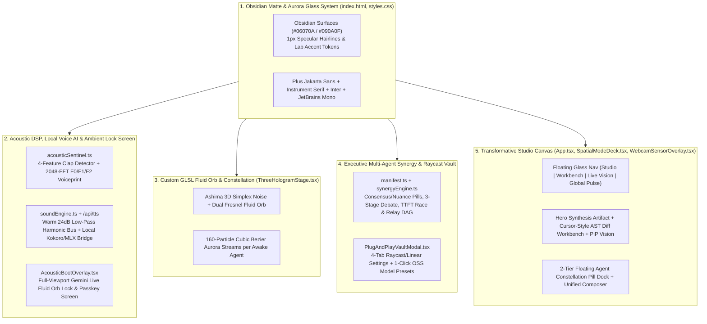

# Aspira — Flagship Multi-Agent Spatial Studio Redesign Plan

## Goal Description

Transform **Aspira** ([`/Users/yosefshammout/archon-hud`](file:///Users/yosefshammout/archon-hud/README.md), tracking [`https://github.com/ysham123/Aspira.git`](https://github.com/ysham123/Aspira)) from a boxy, neon-arcade HUD into a **modern, breathtaking flagship desktop & web studio** that looks and feels like a collaborative release from **Google Gemini, OpenAI, Anthropic, and xAI** (with **Linear / Raycast / Apple visionOS** craft).

Five specialized Principal Architect & Engineer subagents audited every line of the existing codebase and co-designed this unified upgrade:
1. **[Principal UI/UX Design Architect](conversation://63ac7cb2-7149-483b-a1d3-67231aa47e03)** — Obsidian Matte + Specular Hairline Glass + Iridescent Aurora design system, typography (`Plus Jakarta Sans`, `Instrument Serif`, `Inter`, `JetBrains Mono`), and progressive disclosure layout.
2. **[Principal WebGL & Shader Engineer](conversation://f6c3cbd3-79e7-4c20-8dac-22ae92a5792b)** — Custom GLSL **Bioluminescent Fluid Orb** (3D Ashima Simplex Noise + Dual-Layer Fresnel + Volumetric Corona Halo) and **160-Particle Curved Cubic Bezier Aurora Ribbons** for each awake agent core.
3. **[Principal Audio DSP & Biometrics Engineer](conversation://58ee7eae-7938-4f88-99b1-58af2c9a14ff)** — Zero-false-positive 4-feature Clap Envelope Detector, 2048-FFT Parabolic Pitch + Formant (`F0 + F1/F2`) Voiceprint Matcher, **Luxury Ambient Harmonic Sound Bus** (VisionOS glass droplets, suspended ninth wake swells, Lydian Maj9 unlock blooms), and **Local Neural Voice AI Bridge (`mlx-audio` / `Kokoro-82M` / `Orpheus` / macOS Neural TTS)**.
4. **[Principal Multi-Agent Orchestration Engineer](conversation://7c5e2055-4e5e-44c8-8823-5965e843b023)** — Executive Multi-Agent Synergy Engine with **Consensus vs. Unique Model Nuance Attribution Pills**, **3-Stage Adversarial Critique Ledger**, **Speculative Speed Race Leaderboard (`TTFT` + `tok/s`)**, **4-Stage Sequential Relay DAG**, and a **4-Tab Raycast/Linear Studio Vault**.
5. **[Principal Spatial Systems & Workspace Engineer](conversation://70b3f0b2-8f96-418d-9901-b109fd77ab45)** — Four spacious, clutter-free **Transformative Studio Views** (**Studio**, **Workbench**, **Live Vision**, **Global Pulse**), a 2-tier floating **Agent Constellation Pill Dock + Unified Composer**, and a **Compact Picture-in-Picture Optical Companion**.

---

## User Review Required

> [!IMPORTANT]
> **Complete Aesthetic & Architectural Overhaul:**
> - **Eliminating Arcade HUD Tropes:** All neon cyan graph-paper grids, CRT scanlines, `Orbitron` military stencil fonts, and loud labels (`AMBER LOCKDOWN`, `CRIMSON ALERT`, `EXOCORTEX`) will be removed and replaced with deep Obsidian Matte glass (`#090A0F`), `1px solid rgba(255,255,255,0.07)` specular hairlines, and authentic lab palettes (**Argon** `#6E8EFB`, **Claude** `#D97757`, **Grok** `#F43F5E`, **GPT** `#10A37F`).
> - **Parallel Principal Engineer Execution:** Upon your approval of this plan, we will dispatch our specialized Principal Engineer agents to implement these upgrades, verify the production build, and push the release directly to [`https://github.com/ysham123/Aspira.git`](https://github.com/ysham123/Aspira).

---

## Proposed Changes



---

### 1. Design System & Typography Foundation

#### [MODIFY] [index.html](file:///Users/yosefshammout/archon-hud/index.html)
- Replace `Orbitron` and `Rajdhani` Google Fonts with **`Plus Jakarta Sans`**, **`Instrument Serif`**, **`Inter`**, and **`JetBrains Mono`**.
- Update document title to `Aspira — Multi-Agent Spatial Studio` and body background to `#090A0F`.

```diff
-    <title>A.R.C.H.O.N. // Spatial Multi-Model Exocortex</title>
+    <title>Aspira — Multi-Agent Spatial Studio</title>
     <link rel="preconnect" href="https://fonts.googleapis.com">
     <link rel="preconnect" href="https://fonts.gstatic.com" crossorigin>
-    <link href="https://fonts.googleapis.com/css2?family=JetBrains+Mono:wght@300;400;500;600;700&family=Orbitron:wght@400;500;600;700;800;900&family=Rajdhani:wght@400;500;600;700&display=swap" rel="stylesheet">
+    <link href="https://fonts.googleapis.com/css2?family=Instrument+Serif:ital@0;1&family=Inter:wght@300;400;500;600;700&family=JetBrains+Mono:wght@400;500;600&family=Plus+Jakarta+Sans:wght@400;500;600;700&display=swap" rel="stylesheet">
   </head>
-  <body class="bg-[#02060d] text-[#d8f8ff] overflow-hidden select-none">
+  <body class="bg-[#090A0F] text-[#F3F4F6] overflow-hidden select-none antialiased">
```

#### [MODIFY] [styles.css](file:///Users/yosefshammout/archon-hud/src/styles.css)
- Remove `.hud-grid-bg` (38px cyan grid) and `.hud-scanlines::after` (CRT scanlines).
- Define the **Obsidian Matte + Specular Glass + Iridescent Aurora** CSS custom properties (`--bg-void`, `--bg-canvas`, `--surface-glass-1..3`, `--border-subtle`, `--specular-top`, `--shadow-ambient`), utility classes (`.aspira-canvas-bg`, `.aspira-glass`, `.aspira-glass-elevated`, `.aspira-pill`), and refined typography defaults (`Inter` body, `Plus Jakarta Sans` headings, `Instrument Serif` editorial accents).

---

### 2. Custom GLSL WebGL Fluid Aurora Orb & Constellation

#### [MODIFY] [ThreeHologramStage.tsx](file:///Users/yosefshammout/archon-hud/src/components/ThreeHologramStage.tsx)
- Replace all `wireframe: true` `OctahedronGeometry` and `IcosahedronGeometry` meshes and flat `THREE.Line` lasers with a custom WebGL shader pipeline:
  1. **Central Bioluminescent Fluid Orb (`SphereGeometry(1.18, 128, 128)` + Custom `ShaderMaterial`)**:
     - **Vertex Shader (`ORB_VERTEX_SHADER`)**: 3-octave Ashima 3D Simplex Noise (`snoise`) displacing vertices organically along surface normals in response to `uTime`, `uAudioRms`, `uExecBoost`, `uTurbulence`, and `uMorphFlatten`.
     - **Fragment Shader (`ORB_FRAGMENT_SHADER`)**: Dual-layer Fresnel rim lighting ($F_1 = (1 - |\mathbf{N}\cdot\mathbf{V}|)^{2.1}$, $F_2 = (1 - |\mathbf{N}\cdot\mathbf{V}|)^{4.8}$), deep velvet center attenuation (preserving foreground text legibility), and dynamic 4-lobe chromatic mixing weighted by `uAgentWeights` (**Argon** `#6E8EFB`, **Claude** `#D97757`, **Grok** `#F43F5E`, **GPT** `#10A37F`).
  2. **Volumetric Back-Face Corona Halo (`HALO_FRAGMENT_SHADER`, `THREE.BackSide`, `THREE.AdditiveBlending`)**:
     - Soft atmospheric aura around the orb reacting to vocal cadence and execution states.
  3. **Custom GLSL Agent Core Spheres & 160-Particle Curved Cubic Bezier Ribbons (`RIBBON_VERTEX_SHADER` / `RIBBON_FRAGMENT_SHADER`)**:
     - Each agent core is a smooth bioluminescent pearl sphere with a gossamer orbital ring.
     - Awake cores weave 160 soft radial light particles along a swirled 3D cubic Bezier curve (`P0 -> Control1 -> Control2 -> P3`) into the central orb (or sequentially `Core[i] -> Core[i+1]` when `synergyMode === 'relay'`).
  4. **Smooth Mode & Synergy Choreography**:
     - Dynamically interpolates camera position, orb compression, orbital radii, and turbulence across all 4 studio views (`nexus`, `forge`, `overwatch`, `warroom`) and all 4 collaboration modes (`fusion`, `adversarial`, `sprint`, `relay`).

---

### 3. Acoustic DSP, Luxury Sound Engine, Local Voice AI Bridge & Ambient Lock Screen

#### [MODIFY] [acousticSentinel.ts](file:///Users/yosefshammout/archon-hud/src/audio/acousticSentinel.ts)
- Upgrade `fftSize` to `2048` (`~23.4 Hz` resolution) and implement:
  - **4-Feature Physical Clap Discriminator**: Adaptive room noise floor EMA (`noiseFloorRms`), time-domain crest factor (`peak / rms > 2.6`), positive onset derivative (`rms - prevRms`), high-frequency to sub-bass ratio (`1.2–5.5 kHz` vs `100–400 Hz`), and rapid decay verification (`>45%` drop within `65ms`) to eliminate false triggers from speech or desk bumps.
  - **Parabolic Pitch + Formant Ratio Biometrics (`F0 + F1/F2`)**: 3-point parabolic interpolation around `maxVocalBin` for sub-Hz smooth pitch tracking, gated by active speech (`isSpeaking`) with EMA smoothing.
  - **Perceptual Log-Spaced Spectrum Smoothing**: Asymmetric fast-attack (`0.55`) / silky-release (`0.14`) ballistics with subtle idle harmonic breathing.

#### [MODIFY] [soundEngine.ts](file:///Users/yosefshammout/archon-hud/src/audio/soundEngine.ts)
- Replace raw unfiltered `sawtooth` oscillators with a **Master Luxury Acoustic Bus**:
  - `masterGain -> warmFilter (24dB/oct lowpass @ 4200Hz) -> stereoAmbientDiffusion (23ms/37ms filtered delay @ 0.16 wet) -> DynamicsCompressorNode -> destination`.
  - **VisionOS Modal Glass Droplets (`playClapImpulse`)**: Dual-sine modal glass resonator (`528Hz + 1320Hz` on Clap 1; `792Hz + 1584Hz + 264Hz` bloom on Clap 2).
  - **Gemini Live / OpenAI Realtime Awakening Swell (`playAmberLockdown`)**: Detuned stereo `Dmin9 / Fmaj9` warm pad swell (`146.8Hz, 220Hz, 261.6Hz, 329.6Hz, 392Hz`) with a smooth `280Hz -> 1850Hz -> 620Hz` low-pass sweep.
  - **Luxury Lydian Maj9 Studio Unlock Bloom (`playPasskeyVerified`)**: Velvet `C2/C3` sub-bass sine foundation + micro-arpeggiated `Cmaj9(#11)` glass chord.
  - **Muted Sub-Bass Security Pulse (`playIntruderAlert`)** & **Tactile Glass UI Tick (`playGlassTick`)**.
  - **Local Neural Voice AI & Pre-Warmed Prosody (`speak`)**: Attempts local neural TTS bridge (`/api/tts` supporting local `mlx-audio` / `Kokoro-82M` / `Orpheus` / OpenAI-compatible local TTS servers) and falls back seamlessly to pre-warmed macOS Premium Neural Voices (`Ava`, `Zoe`, `Daniel`, `Samantha`).

#### [MODIFY] [AcousticBootOverlay.tsx](file:///Users/yosefshammout/archon-hud/src/components/AcousticBootOverlay.tsx)
- Replace the boxed diagnostic modal with a **full-viewport Ambient Voice & Clap Lock Screen** (`bg-[#06070A]/70 backdrop-blur-xl`):
  - Leaves the center viewport open so the 3D WebGL Fluid Aurora Orb breathes directly behind the typography.
  - Displays a sleek **3-Step Acoustic Handshake Pill Bar** (`① First Clap` · `② Double-Clap Armed` · `③ "Wake up, I'm back"`), an editorial `Instrument Serif` / `Plus Jakarta Sans` headline, and a centered symmetrical 24-node **Harmonic Waveform Ribbon**.
  - In Passkey Resonance state, displays a single floating **Vocal Harmonic Match Pill** (`96.8% Vocal Match · 144 Hz · 1180 Hz Centroid` + 1-click `Calibrate Voice`), a minimal glass passkey input pill, and 4 sleek horizontal glass cards for the passkey protocols.

---

### 4. Multi-Agent Orchestration, Capability Matrix & Raycast/Linear Studio Vault

#### [MODIFY] [manifest.ts](file:///Users/yosefshammout/archon-hud/src/plugins/models/manifest.ts)
- Update [`BUILTIN_MODEL_PLUGINS`](file:///Users/yosefshammout/archon-hud/src/plugins/models/manifest.ts#L101-L207) with the authentic Tier-1 AI Lab color palettes (`#6E8EFB`, `#D97757`, `#F43F5E`, `#10A37F`), `endpointConfig` (`providerType`, `baseUrl`, `apiModelId`), and `badgeLabel` / `uniqueContribution` metadata on each capability role.
- Extend [`SynergyExecutionResult`](file:///Users/yosefshammout/archon-hud/src/plugins/models/manifest.ts#L434-L459) with `executiveHeadline`, `attributionPills` (`consensus` vs. `unique_nuance`), `debateLedger` (`THESIS` $\rightarrow$ `RED_TEAM_CRITIQUE` $\rightarrow$ `HARDENED_VERDICT`), `sprintLeaderboard` (`ttftMs`, `totalLatencyMs`, `deltaFromWinnerMs`), and `relayPipeline` (`Stage 1..4` batons and artifacts).

#### [MODIFY] [synergyEngine.ts](file:///Users/yosefshammout/archon-hud/src/plugins/models/synergyEngine.ts)
- Implement genuine mode-specific orchestration across awake models:
  - **`fusion`**: Synthesizes a cohesive **Executive Brief** (`executiveHeadline` + `synthesizedOutput`) and extracts interactive **Consensus Pills** (`✦ Shared Agreement`) and **Model-Tinted Unique Nuance Pills** (`◆ Argon 2M Vault`, `◆ Claude AST Boundary`, `◆ Grok Edge-Case Hardening`, `◆ GPT Tool Schema`).
  - **`adversarial`**: Generates a structured 3-stage **Adversarial Critique Ledger** where Stage 1 proposes the thesis, Stage 2 challenges hidden assumptions, and Stage 3 locks the hardened verdict.
  - **`sprint`**: Measures `ttftMs` and `totalLatencyMs`, ranks the fastest core as `SPECULATIVE_WINNER`, and assigns remaining awake cores as `ASYNC_VERIFIER`.
  - **`relay`**: Executes a sequential 4-stage capability handoff chain passing explicit `inputBaton` and `outputArtifact` payloads across awake models.

#### [MODIFY] [PlugAndPlayVaultModal.tsx](file:///Users/yosefshammout/archon-hud/src/components/PlugAndPlayVaultModal.tsx)
- Redesign into a **4-Tab Raycast / Linear Command & Settings Sheet**:
  1. **`Models & Hot-Plug`**: Active agent roster with `LIVE API` vs `NEURAL SIM` status pills, **1-Click Open-Source Presets** (`DeepSeek-R1`, `Qwen-2.5-Coder 32B`, `Llama-3.3 70B`, `Local Ollama`), and custom endpoint/model hot-plug form.
  2. **`API Keys & Local Voice AI`**: Masked provider key inputs for **Argon (Gemini)**, **Claude**, **Grok**, **GPT**, plus a **Local Voice AI Endpoint (`mlx-audio` / `Kokoro-82M` / `Orpheus`)** selector.
  3. **`Spoken Passkeys`**: Clean Linear-style rows for editing custom passkey phrases (`Protocol Lazarus`, `House Party Protocol`, `Overwatch Alpha`, `Ghost Protocol`) and inspecting woken model badges.
  4. **`Vocal Biometrics`**: Live harmonic comparison (`Enrolled Profile` vs `Live Mic F0/Centroid`) with 1-click vocal calibration.

#### [MODIFY] [server/index.js](file:///Users/yosefshammout/archon-hud/server/index.js)
- Increase `/api/fs-graph` file preview slice from `1200` to `4000` characters for rich code inspection in the Workbench.
- Upgrade `/api/dispatch` to support custom `openai_compatible` and `ollama` base URLs (`endpointConfig.baseUrl`) and return server-measured `latencyMs`.
- Add `/api/tts` proxy endpoint that forwards speech synthesis requests to a local **`mlx-audio` / `Kokoro-82M` / OpenAI-compatible local TTS server** (e.g., `http://localhost:8880/v1/audio/speech`) when available, returning `{ localNeuralAudio: false }` gracefully when offline so the browser uses pre-warmed macOS Neural Voices.

---

### 5. Transformative Studio Canvas, Floating Agent Dock & PiP Optical Companion

#### [MODIFY] [SpatialModeDeck.tsx](file:///Users/yosefshammout/archon-hud/src/components/SpatialModeDeck.tsx)
- Redesign all 4 modes into spacious, clutter-free **Studio Views**:
  1. **Studio (`nexus`)**:
     - Top floating **Segmented Capability Filter Bar** (`Shared Overlaps (5)` | `Apex Exclusives (4)` | `All (9)`) + **Synergy Mode Segmented Control** (`Fusion` · `Debate` · `Speed Race` · `Relay`).
     - Left/Center **Hero Executive Synthesis Artifact Card** displaying `executiveHeadline`, `synthesizedOutput`, interactive **Consensus vs. Unique Nuance Attribution Pills**, and mode-specific views (**3-Stage Debate Ledger**, **Speed Race Velocity Chart**, or **Relay Handoff DAG**).
     - Right **Side-by-Side Agent Perspective Cards** with `2px` signature lab accent bars (`#6E8EFB`, `#D97757`, `#F43F5E`, `#10A37F`), role badges, and `ms` / `tok/s` metrics.
  2. **Workbench (`forge`)**:
     - Left **Repository AST & Symbol Tree** with instant search filter and clickable `ƒ symbol` pills.
     - Right **Cursor / Claude Artifacts Split Workbench** featuring a `Source Inspector` vs `Multi-Agent AST Diff` toggle (with `+` emerald and `-` rose diff highlights), line-numbered code viewer, and a **Collapsible macOS Terminal Drawer** at the bottom.
  3. **Live Vision (`overwatch`)**:
     - Clean **Gemini Live / Apple visionOS Optical Stage** with subtle hairline crop marks, spatial bounding overlays, and autonomous **Claude Computer Use + Argon Spatial Vision** action timeline.
  4. **Global Pulse (`warroom`)**:
     - Left **Editorial Live Recon Cards** (`Grok X Firehose`, `Argon Search Grounding`, `Claude MCP Audit`) with 1-click `"Debate This Signal"` triggers.
     - Right **Structured Multi-Agent Debate Timeline** (`Thesis → Red-Team Critique → Grounded Verification → Arbiter Verdict`).

#### [MODIFY] [WebcamSensorOverlay.tsx](file:///Users/yosefshammout/archon-hud/src/components/WebcamSensorOverlay.tsx)
- Replace the bulky footer box with a **Minimalist Optical Companion Pill** when the camera is off, and a sleek floating **Picture-in-Picture (PiP) Glass Card** (`rounded-2xl border border-white/15 bg-[#090A0F]/90 shadow-2xl`) with refined hairline face/hand reticles when `Live Cam` is active.

#### [MODIFY] [App.tsx](file:///Users/yosefshammout/archon-hud/src/App.tsx)
- Replace the heavy top header and crowded 12-column footer with the **3-Layer Spatial Studio Layout**:
  - **Layer 1 (Top Floating Glass Bar)**: `Aspira` wordmark + quiet macOS telemetry pill (`M2 Pro · CPU · RAM · Voice Match`), centered **4-Mode Segmented Pill Track** (`Studio` | `Workbench` | `Live Vision` | `Global Pulse`), and right action pills (`Models & Keys`, `Audio`, `Lock`).
  - **Layer 2 (Transformative Stage)**: Open spatial canvas showcasing the 3D Fluid Aurora Constellation + active `SpatialModeDeck` view.
  - **Layer 3 (2-Tier Floating Agent Constellation Dock + Unified Composer)**:
    - **Tier A**: Centered row of tactile glass pills for **Argon**, **Claude**, **Grok**, and **GPT** (plus any hot-plugged models), `Wake All`, and the compact `Optical Gesture Rig` trigger.
    - **Tier B**: Raycast/Claude-style **Unified Command & Voice Composer Bar** with live microphone waveform indicator, natural language prompt input, and primary `Run` button.

---

## Verification Plan

### Automated Tests
1. **TypeScript & Vite Production Build Verification**:
   ```bash
   npm run build
   ```
   Verify zero TypeScript compilation or Vite bundling errors in `/Users/yosefshammout/archon-hud`.
2. **Backend API & Telemetry Smoke Verification**:
   ```bash
   curl -s http://localhost:5173/api/telemetry
   curl -s http://localhost:5173/api/fs-graph | head -c 400
   curl -s -X POST http://localhost:5173/api/dispatch -H "Content-Type: application/json" -d '{"modelId":"argon","prompt":"Verify Aspira studio synthesis"}'
   ```
3. **Git Commit & Push to GitHub**:
   ```bash
   git status -s && git push origin main
   ```

### Manual Verification
1. **Ambient Clap + Wake Phrase + Passkey Lock Screen**:
   - Open `http://localhost:5173` (or the native macOS desktop window). Verify the serene Obsidian Matte lock screen with the central 3D WebGL Fluid Aurora Orb.
   - Clap twice + say *"Wake up, I'm back"* (or click `Simulate Wake Handshake`), verify the warm suspended ninth chord and natural voice prompt (*"Welcome back. Acoustic signature recognized. Please state your passkey."*), and speak or select `"Protocol Lazarus"` or `"House Party Protocol"`.
2. **Transformative Studio Views & Multi-Agent Synergy**:
   - Toggle between `Fusion`, `Debate`, `Speed Race`, and `Relay` in **Studio** view and verify the Executive Synthesis Brief, Consensus vs. Nuance Pills, 3-Stage Debate Ledger, and 3D Bezier Aurora Ribbons update smoothly.
   - Switch across **Studio**, **Workbench** (inspecting source + `Multi-Agent AST Diff` + collapsible macOS terminal), **Live Vision**, and **Global Pulse**, and test the **4-Tab Raycast/Linear Studio Vault** (`Models & Keys`).
